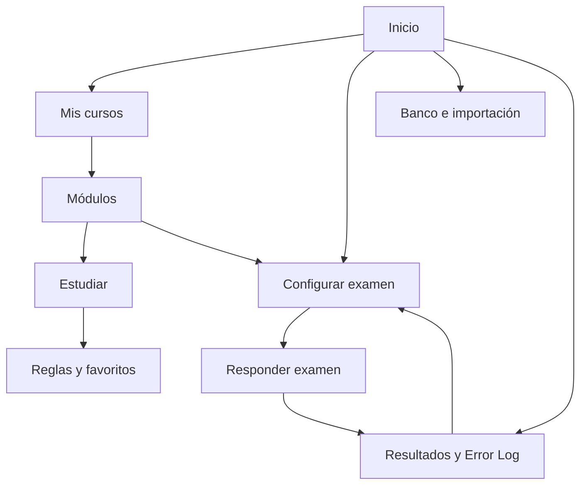
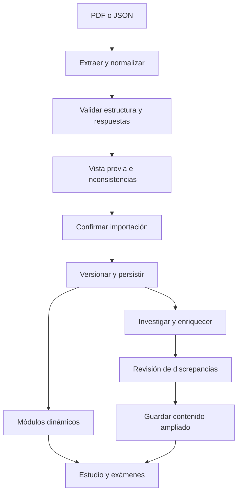
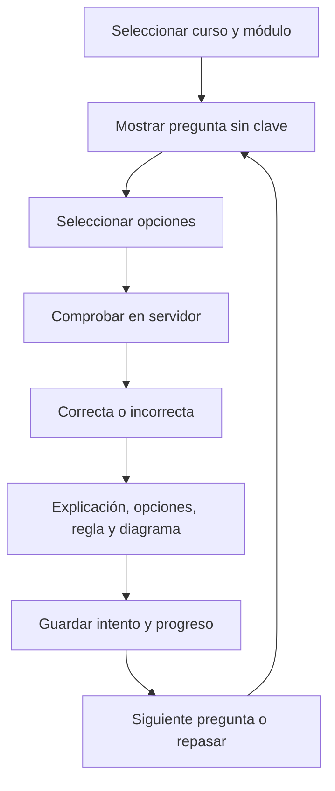
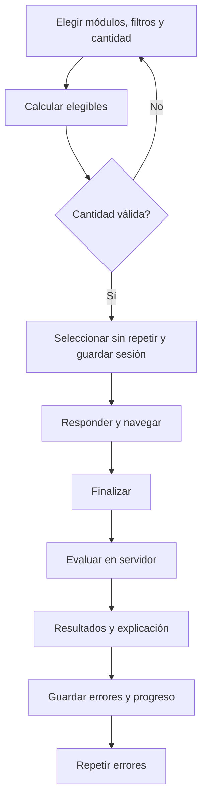

# Flujos funcionales

## Navegación

## Importación

## Estudio

## Examen

Modo práctica: comprobar cada pregunta y revelar explicación; modo examen: mantener claves ocultas hasta finalizar. La composición y orden no cambian al recargar. El enriquecimiento es independiente de la disponibilidad del banco.
